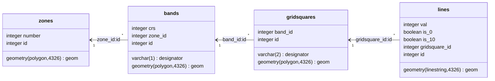

# MGRS-Creator

Tool zur Erzeugung eines globalen MGRS-Koordinatengitters in einer PostGIS-Datenbank.

Diese Gitter kann anschliessend beispielsweise für die Erstellung eines WMS oder zur Erzeugung von Vectorkacheln verwendet werden.

## Datenbankmodell



## Datenbankverbindung

Die Datenbankverbindung wird in `database.ini` unter `[database]` als `url`
konfiguriert. Alembic verwendet diese Datei für Online- und Offline-Migrationen.
Die SQLAlchemy-Engine verwendet dieselbe Konfiguration.

Sonderzeichen in Benutzername und Passwort müssen in der URL prozentkodiert sein.

Die Datenbank muss vor der ersten Migration erstellt werden.

Die PostGIS-Extension muss in der Datenbank installiert sein.

```postgresql
create extension postgis;
```
Die Migrationen werden mit `alembic upgrade head` durchgeführt.